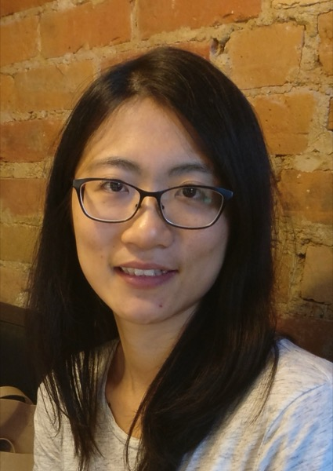

<aside class="profile">
  
  <h1>{{ site.owner.name }}</h1>
  
{{ site.owner.bio }}

  

    <a href="https://scholar.google.com/citations?user={{ site.owner.google_scholar }}">Google Scholar</a>
    <a href="https://linkedin.com/in/{{ site.owner.linkedin }}">LinkedIn</a>
    <a href="/files/cv.pdf">CV</a>
  

</aside>

Hihi 👋, I'm Cecilia. Currently, I am a postdoctoral researcher at [LTL](https://ltl.mmll.cam.ac.uk/) at the University of Cambridge.

My research interests are:
1. Cultural adaptation and alignment (for example: [CLCA](https://aclanthology.org/2025.acl-long.156/), [CARSI](https://arxiv.org/pdf/2611.08334)),
   particularly leveraging ideas from social learning or in multi-agent setups.
   Additionally, I am interested in cultural evaluations in situated social contexts.
2. Efficient and low-resource methods for multilingual NLP (an example: [FUN](https://aclanthology.org/2024.naacl-long.111/)).
3. Methods and analyses of models inspired by developmental psychology, neuroscience, or social psychology.
4. Applications in education, healthcare, psychotherapy, and the creative industries, emphasizing multilinguality and cultural adaptation (an example: [CultureCare](https://arxiv.org/pdf/2508.07902)).

I appreciate pure deep learning methods, but I'm equally drawn to ideas for NLP grounded in theories and insights from other disciplines,
such as sociology, anthropology ... maybe a bit too broad for my own good.

If you are interested in collaboration 📜, feel free to contact me via email: cl2002 (AT cam.ac.uk).
For the most up-to-date publication list, please see my [Google Scholar](https://scholar.google.com/citations?hl=en&user=eNFB3fgAAAAJ&view_op=list_works&sortby=pubdate) page.

If you are a student at Cambridge and looking for a project, please see [here](https://ltl.mmll.cam.ac.uk/student_project).

---

Here are some of the works that I've done during my PhD, and I am still very interested in these ideas:
* Cross-lingual generalization (e.g., plasticity, spurious correlations etc.: [FUN](https://aclanthology.org/2024.naacl-long.111/), [Early training](https://arxiv.org/abs/2403.15210))
* Culturally aware and adapted NLP ([MAPS](https://aclanthology.org/2024.naacl-long.112/), [Survey](https://aclanthology.org/2025.tacl-1.31/))
* Multimodality ([FigMemes](https://aclanthology.org/2022.emnlp-main.476/), [xVQA](https://aclanthology.org/2023.findings-eacl.186/))

Previously, I was doing my PhD at [TU Darmstadt](https://www.informatik.tu-darmstadt.de/fb20/index.en.jsp) ([UKP Lab](https://www.informatik.tu-darmstadt.de/ukp/ukp_home/index.en.jsp)), Germany.
Prior to returning to research, I spent nearly a decade in industry working in the field of NLP.
Earlier, I studied at the University of Toronto (BASc and MASc, [PSI Lab](https://psi.toronto.edu/)).
